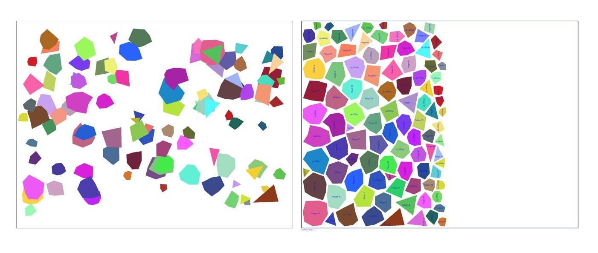

# FreeNest for Illustrator

FreeNest for Illustrator - A free, open-source nesting plugin for Adobe Illustrator

Arrange vector parts for cutting and add single-stroke labels from Illustrator object names. Powered by [OpenNest](https://github.com/petrasvestartas/OpenNest).

**Pre-release.** The current source is prepared for **0.2.0**. FreeNest targets **Illustrator 2024 (28.x) on Windows x64**. Other Illustrator versions and macOS have not been verified. This is an independent project.

The features below describe the current source. The [0.1.0 release notes](release-notes/0.1.0.md) describe the original pre-release; symbol nesting and 30-degree turns are newer work.

*The same parts before nesting (left) and after packing and labeling (right), leaving a large unused area on the output sheet.*

## Use cases

FreeNest is built primarily for **laser cutting** and **vinyl cutting**. Arrange parts on a sheet of plywood or acrylic, or fit more decal shapes into a defined section of vinyl. Set the spacing between parts and the margin from the material edge to suit your process.

The same approach works for CNC routing, cutting stencils or templates, and other jobs where arranging 2D parts more tightly can reduce material waste. Use rectangular sheets for standard stock or trace a usable boundary to nest parts on an irregular offcut.

## Get started

If a Windows ZIP is available under **Releases** on GitHub, download the file named `FreeNest-for-Illustrator-…-Windows-x64.zip` and follow the [installation instructions](packaging/INSTALL.md). GitHub's automatically generated **Source code** archives do not contain the plugin. The Illustrator SDK is only needed to build from source.

In Illustrator, select your parts and choose **Object > FreeNest > Nest Selected Paths**. For repeated use, open the dockable panel under **Window > FreeNest**. See the [feature guide](native/README.md) for settings and [sample documents](examples/illustrator-tests) for test artwork.

## Features

- Nest linked symbol instances as whole parts using their actual contour when defined by one closed path (including hexagons). Complex symbols use visible rectangular bounds. Original and nested instances remain linked.
- Nest closed paths and compound paths with holes while preserving original artwork and Bézier geometry. Smaller parts can nest in available holes.
- Initialize sheet dimensions and units from the current document; choose spacing, margins, permitted rotations (including 30-degree steps) and a time limit.
- Place copies on output artboards, with optional overflow across multiple sheets.
- Capture a simple closed path as an irregular sheet, including concave or curved boundaries. Output artboards surround the shape; optional overflow repeats it.
- Generate object-name labels using OpenNest's VDA single-stroke font, independently or during nesting.
- Choose label height, regular/bold font, stroke weight, and Black, Blue, Red or Magenta.
- Default labels are blue, 0.1 pt, with a 0.125 in (3.175 mm) nominal maximum height.
- Group labels with their polygons or put label groups on a separate layer.
- Elapsed time, approximate remaining time and a completion report covering placed parts and labels.
- Cooperative cancellation and containment, rotation and spacing validation before document edits.

Ordinary groups, disconnected compound islands, nested islands, sheet holes, clipping masks, open paths, raster art and live text are unsupported. Compound parts with one outer contour and disjoint enclosed holes are supported. Labels currently accept printable ASCII object names up to 128 characters. Heuristic packing is not guaranteed globally optimal.

## Build from source

Install Visual Studio 2022 or 2026 with C++/CMake tools, Git, Python 3.12+ and the separately obtained Illustrator 2024 SDK. From the repository root, run:

    ./native/build-native.ps1 -IllustratorSDKRoot 'C:/SDKs/Adobe Illustrator 2024 SDK'

The tested OpenNest revision is fetched automatically. Output goes to native/package/FreeNest. The Adobe SDK is referenced in place and is not included.

A fresh checkout builds without installing or publishing. After closing Illustrator, deliberately install with:

    ./native/deploy-native.ps1

The default destination is Illustrator 2024's Plug-ins/Development folder. Keep FreeNest.aip and nfp_nest.dll together, restart Illustrator, and choose **Object > FreeNest > Nest Selected Paths** or **Object > FreeNest > Label Selected Paths**.

For one-click access, open **Window > FreeNest**. Its compact native panel contains buttons for nesting, labeling and capturing a sheet boundary. Drag the panel by its title tab to dock it beside other Illustrator panels; the buttons open the same dialogs as the Object menu commands.

## Versioned releases

`VERSION` sets the About dialog, Windows plugin metadata and release ZIP filename. The original `v0.1.0` tag is preserved. See the [0.2.0 pre-release notes](release-notes/0.2.0.md) for changes since that tag.

Run `./prepare-release.ps1` to build, run native and independent geometry checks, and prepare `dist/<version>/` with a Windows ZIP, release notes and SHA-256 checksum. The Adobe SDK and test dependencies are required on the build machine; the SDK is not included in the download. Preparation never installs or publishes the plugin, creates a commit or makes a tag.

Release notes live in `release-notes/<version>.md`. Before a new version, update `VERSION` and add matching notes. Re-running preparation replaces the local candidate for that version; after publishing, use a new version for changes. When ready for GitHub, commit the tested source, tag it `v<version>`, and attach the ZIP, notes and checksum to that version's release manually. The current GitHub workflow runs checks only.

## Use FreeNest

The commands are under **Object > FreeNest**:

- **Nest Selected Paths** opens the nesting modal for selected closed paths, compound parts, or symbol instances. Originals stay in place; results go on new output artboards and a **FreeNest Results** layer.
- **Label Selected Paths** opens the labeling modal. Labels use object names from Illustrator's Layers panel and fall back to the definition name for unnamed symbol instances. Grouped placement wraps each source part and label in a group; separate-layer placement leaves the source hierarchy intact.
- **Use Selected Path as Sheet** captures one simple closed path as an irregular sheet. Deselect the boundary, select the parts, then open the nesting modal with **Use captured boundary as sheet** checked. Capture again after editing the boundary; the snapshot lasts only for the loaded plugin session.

Output artboards are rectangular even when the usable sheet is irregular. Additional sheets repeat the same shape. Uncheck **Include sheet boundary** to omit the drawn boundary; packing is still constrained to the sheet.

### Initial defaults

| Setting | Default |
| --- | --- |
| Units | Current document ruler units; label options inherit the selected units |
| Rectangular sheet size | Active artboard width and height |
| Contour spacing | 0.125 in (3.175 mm) |
| Sheet-edge margin | 0.125 in (3.175 mm) |
| Include sheet boundary | On |
| Label sheet boundary | Off; optional sheet-name label outside the sheet |
| Additional artboards / labels during nesting | Off |
| Label height | 0.125 in (3.175 mm) nominal maximum; shrinks to fit |
| Label appearance | Blue RGB (0, 0, 255), 0.1 pt stroke |
| Label placement | Group with each polygon |

See the [feature guide](native/README.md) for all controls and examples. Up to 500 selected parts are supported; each compound object counts as one part. Compound holes must be disjoint and fully enclosed. Touching/overlapping contours are unsupported. Spacing excludes artwork strokes and effects. Remaining time is approximate; validation, labeling and applying artwork can extend the calculation time.

[Build and test instructions](docs/BUILDING.md) | [Feature guide](native/README.md)

## Repository layout

| Path | Purpose |
| --- | --- |
| native/Source | Illustrator integration, dialogs, geometry and solver adapter |
| native/Resources | Dialog resources; PiPL metadata is generated locally |
| native/tests | Native checks and independent geometry checks |
| dependencies/opennest.json | Pinned upstream revision |
| examples/illustrator-tests | Shared Illustrator documents for manual functionality tests |
| packaging | Packaging inputs and license notices |
| vendor, build, native/package | Ignored dependencies and generated output |

## Verification and limitations

Native and independent geometry checks cover rectangular/irregular sheets, containment, non-overlap, spacing, rotations, multiple sheets, curve flattening, compound fill rules, nesting inside holes, cancellation, units and VDA label clearance.

Development builds have been exercised in Illustrator. The [live Illustrator checklist](docs/BUILDING.md#test-inside-illustrator) remains the release checklist for selection, dialogs, appearance, undo/redo and rollback; automated geometry tests do not verify all host behavior.

The [Windows CI workflow](.github/workflows/checks.yml) runs geometry checks without the Adobe SDK and does not build or publish the Illustrator plugin. Follow the live-check checklist before distributing binaries.

Packing styles include **Narrow strip** (default), **Compact area**, and **Tight fit**. Optional **Center finished layouts** centers each completed nest without moving sheet boundaries. Irregular sheets retain their original layout if centering would violate the boundary or margin.

## About FreeNest

Choose **Object > FreeNest > About FreeNest** to see the installed plugin version and open the GitHub repository. The About dialog is available with no document open.

## License and credits

FreeNest for Illustrator is created and maintained by **RJ Duran**. Original project code is copyright (c) 2026 RJ Duran and uses the [MIT license](LICENSE). OpenNest is developed by Petras Vestartas and includes geometry components with their own notices. See [third-party notices](THIRD_PARTY_NOTICES.md) and retained credits. The Adobe SDK is a separate prerequisite under Adobe's terms; it is not relicensed by this project.

External contributions are not currently being accepted. See [SECURITY.md](SECURITY.md) for security reporting.
